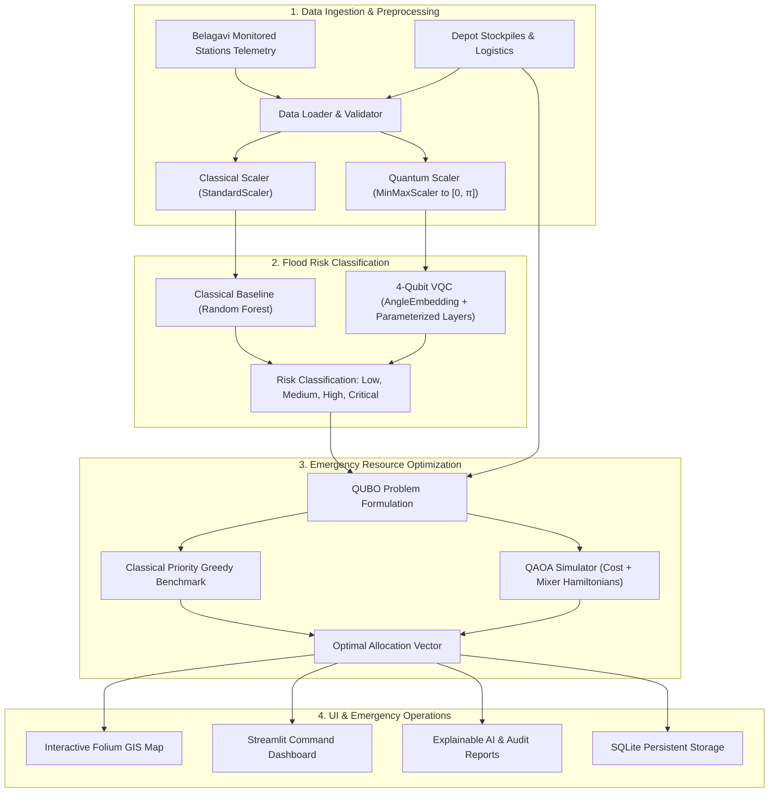
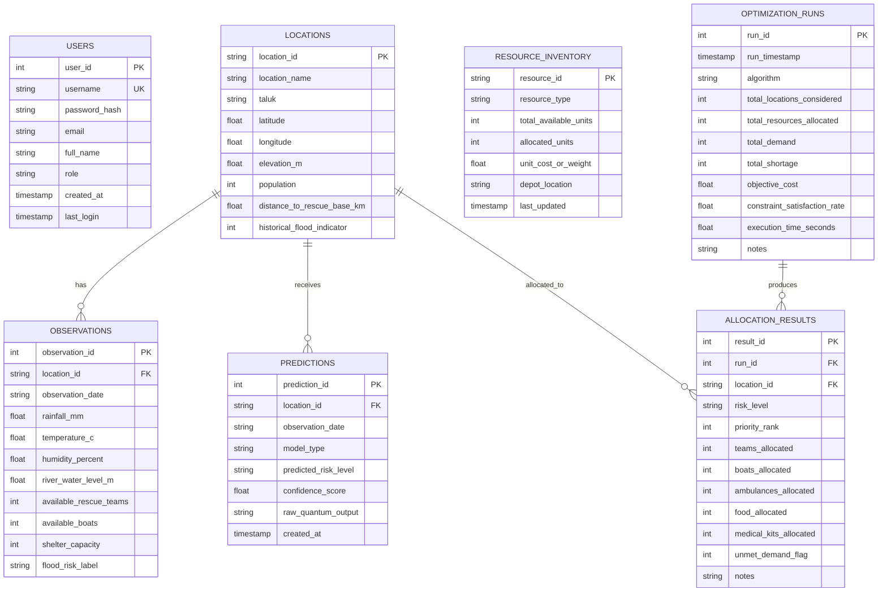

# System Architecture — Q-Rescue

**Hybrid Quantum–Classical Framework for Flood Risk Prediction and Emergency Resource Allocation using VQC and QAOA**

APS College of Engineering, Bengaluru  
Department of Information Science and Engineering

---

## 1. High-Level Architectural Overview

Q-Rescue bridges physical flood hazard estimation and rapid logistical dispatch through a hybrid quantum–classical pipeline:

---

## 2. Component Deconstruction

### 2.1 Web Presentation Layer (`Streamlit`)
- **`app.py`**: Entry landing page, session-aware authentication, executive metrics summary, and academic details.
- **`pages/1_📊_Dashboard.py`**: Real-time hazard monitoring, summary metric cards, Plotly risk donut & scatter matrix, searchable station table.
- **`pages/2_🔮_Risk_Prediction.py`**: Interactive inference for custom inputs or station presets, VQC vs Random Forest toggle, confidence and Pauli-Z expectation readout.
- **`pages/3_📦_Resource_Inventory.py`**: Central depot equipment ledger (Rescue teams, boats, ambulances, rations, medical kits).
- **`pages/4_⚛️_QAOA_Optimization.py`**: Parameterized QUBO optimization, execution of QAOA and Classical baselines, shortage alerts, and CSV export.
- **`pages/5_🗺️_Risk_Map.py`**: Folium OpenStreetMap visualization centered on Belagavi district with risk markers and DEOC dispatch base.
- **`pages/6_📈_Model_Evaluation.py`**: Fair benchmark comparison on identical test split, confusion matrices, and VQC training curves.
- **`pages/7_💡_Explainable_AI.py`**: Quantum circuit blueprints, QAOA trade-off weightings, and plain-English natural language case studies.
- **`pages/8_📜_History.py`**: SQLite historical observation archive and past optimization run records.
- **`pages/9_📁_Data_Management.py`**: Telemetry CSV uploader, range validator, database table inspector, and re-seeding tool.
- **`pages/10_ℹ️_About.py`**: VTU academic project details, faculty guide, HOD, student team, and literature survey.

### 2.2 Business Logic & Machine Learning (`src/`)
- **`src/database.py`**: SQLite connection pooling (WAL mode, foreign keys), schema migrations, transactions, and CRUD operations.
- **`src/authentication.py`**: Bcrypt salted password hashing, credential validation, session state management.
- **`src/data_loader.py`**: Strict schema checking, physical range validation, missing value diagnosis, and data quality reports.
- **`src/preprocessing.py`**: Imputation of physical defaults, MinMax angle scaling to $[0, \pi]$ for quantum circuits, leak-free train/test split.
- **`src/classical_model.py`**: 100-estimator Random Forest classifier with balanced class weighting, Gini feature importance, and full classification metrics.
- **`src/vqc_model.py`**: 4-qubit Variational Quantum Classifier using PennyLane, AngleEmbedding, parameterized rotation layers, circular CNOT entanglement, and multi-qubit Pauli-Z expectation readout.
- **`src/qaoa_optimizer.py`**: Multi-resource allocation formulated as a Quadratic Unconstrained Binary Optimization (QUBO) problem, mapped to an Ising Hamiltonian, and solved via PennyLane QAOA.
- **`src/resource_allocation.py`**: Dispatch orchestration, shortage calculations, CSV formatting, and database persistence.
- **`src/explainability.py`**: Circuit deconstruction, XAI explanations, and plain-English narrative generation.
- **`src/visualizations.py`**: Plotly charts adhering to a dark disaster-management color palette.
- **`src/map_utils.py`**: Verified Belagavi district GIS mapping with Folium.

---

## 3. Database Schema

The SQLite schema (`data/q_rescue.db`) manages 7 core relational tables:

